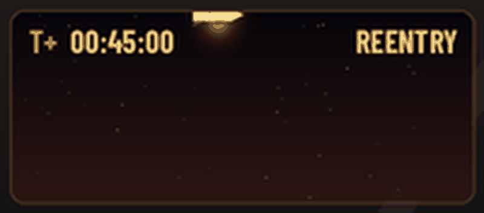
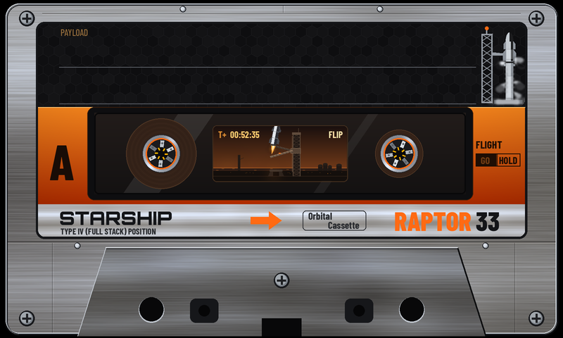
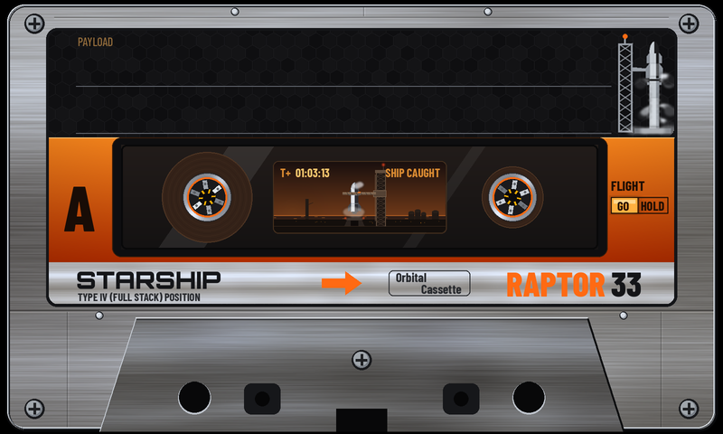

# Starship tower-catch cassette skin for Wampy

A fan-made, SpaceX Starship–themed skin for [Wampy](https://github.com/unknown321/wampy), the Winamp/cassette interface add-on for Sony Walkman players.

It has two parts:

- **Cassette tape + animated reel (`starship`).** The tape is brushed stainless steel and reads "STARSHIP / Raptor 33 / Orbital Cassette". The tape window plays a ~20-second mission loop with a running T+ clock: pad countdown, liftoff, max-Q, hot staging, booster splashdown, orbit insertion, and then a top-down **Mechazilla tower catch** of the ship. In the catch, the ship comes in on reentry, belly-flops down from above, relights and flips, and then the landing burn drops it between the chopsticks. The arms close, the ship settles, steam vents, and "SHIP CAUGHT" blinks. The reels spin and the FLIGHT GO light blinks throughout.
- **Matching Winamp 2.x classic skin (`Starship.wsz`)** in the same steel/amber style.



▶ **Full-screen video:** [previews/starship_catch_v9_share.mp4](previews/starship_catch_v9_share.mp4)

| Flip + relight | Ship caught |
|---|---|
|  |  |

## Download

**[starship-wampy-all-v9.zip](https://github.com/jsnchz89/starship-wampy/releases/download/v1.0/starship-wampy-all-v9.zip)** (from the [v1.0 release](https://github.com/jsnchz89/starship-wampy/releases/tag/v1.0))

The zip contains only skin files:

```
wampy/
└── skins/
    ├── winamp/Starship.wsz
    └── cassette/
        ├── tape/starship/   tape.pkm  tape.jpg  config.txt
        └── reel/starship/   atlas.pkm atlas.txt config.txt reel_00.jpg … reel_113.jpg
```

## Install

1. Connect the Walkman to your computer with USB. Open the **internal storage** drive (usually named **WALKMAN**), not the SD card.
2. If you've installed an older `starship` reel before, delete the folder `wampy/skins/cassette/reel/starship/` first.
3. Unzip `starship-wampy-all-v9.zip` at the **top level** of that drive, so you end up with `WALKMAN/wampy/skins/...`. Let it replace existing files.
4. Eject the drive safely, unplug, and **restart the player**.
5. Open Wampy by flipping the Hold switch, then go to Settings → **Skin** → **Cassette**. In the Codec / Tape / Reel table, set **Tape = `starship`** and **Reel = `starship`** for every codec row you use.
   The first load takes a few seconds with nothing on screen. That's normal.
6. Optional, for the Winamp skin: Settings → **Skin** → **Winamp**, pick `Starship.wsz`, and tap **Load skin**.

You can also force this cassette for one music folder. Put a `cassette.txt` file in that folder containing:

```
tape: starship
reel: starship
```

## Compatibility

- Made for Wampy v1.14.x. It uses Wampy's standard cassette format: an 800×480 tape, plus an ETC1-compressed reel atlas with a `delayMS` config and JPEG fallbacks.
- Wampy runs on Sony **NW-A50 / ZX300 / WM1A / WM1Z** (and A40/A30 with Walkman One). See [Wampy's device table](https://github.com/unknown321/wampy#device-support).
- The reel atlas is 3732×4028, under the 4096 px texture limit.
- **Status: not yet tested on hardware.** The previews are rendered from the actual skin files. If you try it, feedback is welcome in Issues.

## Credits

- [Wampy](https://github.com/unknown321/wampy) by unknown321. All the player magic is theirs; this is just a skin.
- Skin art made by [@jsnchz89](https://github.com/jsnchz89).

## Disclaimer

This is a **fan-made tribute**. It is not affiliated with, sponsored by, or endorsed by SpaceX. "Starship", "Raptor" and related names belong to their respective owners. The artwork is original and contains no SpaceX logos. WALKMAN is a trademark of Sony.
